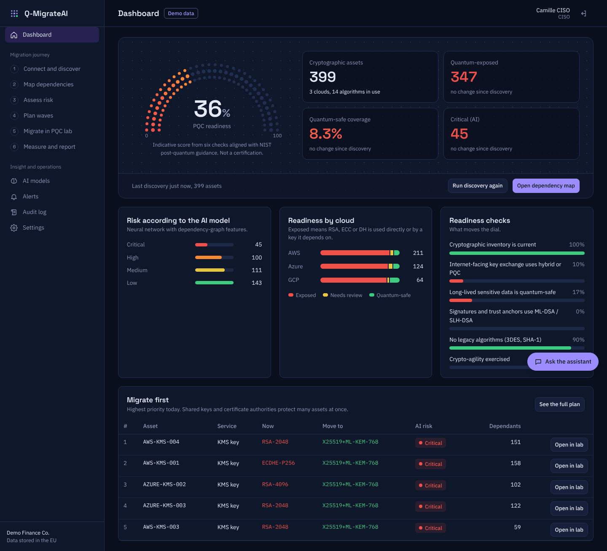
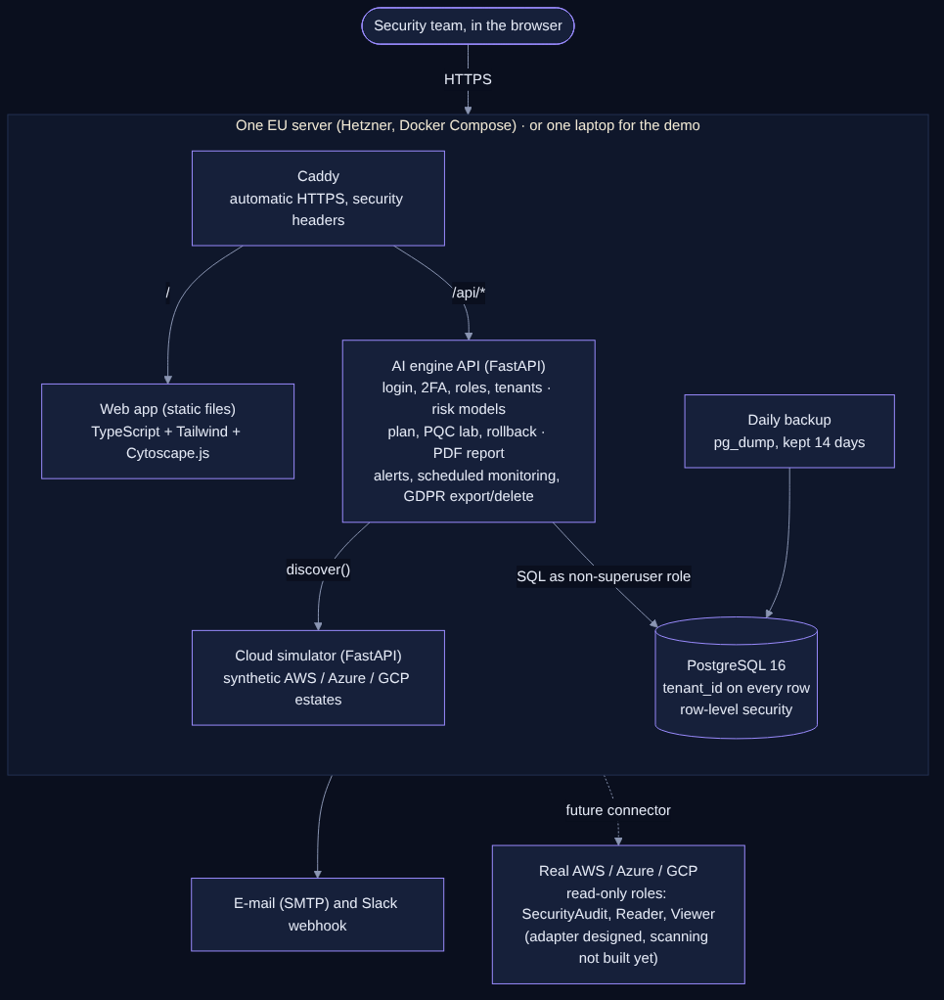

# Q-MigrateAI platform

**AI-driven, risk-aware post-quantum migration and crypto-agility for multi-cloud environments.**
MSc Cybersecurity project, ESAIP Angers. Team: BHOSALE Vijay Dipak (cyber / PQC lead), JIBU Mereena Mariam (AI / ML lead),
CHAPPAN PUTHIYA PURAYIL Abdul Fathah (cloud / data lead). Guide: CHABI ADJOBO Esther.

Q-MigrateAI finds the keys, certificates and TLS endpoints a quantum computer would break, maps what depends on them,
ranks them with AI, plans the migration in waves, moves assets to NIST post-quantum algorithms with validation and
rollback, and measures the result.



> **Real data.** Discovery measures the public websites of real organisations live: post-quantum readiness of the TLS key
> exchange (X25519MLKEM768), certificate chains and the cloud that hosts each site. No synthetic data is used by default.
> Your own AWS, Azure and Google Cloud accounts can be connected read-only: [docs/CLOUD_SETUP.md](docs/CLOUD_SETUP.md).
> See [docs/REAL_DATA.md](docs/REAL_DATA.md) and
> [docs/REAL_VS_SIMULATED.md](docs/REAL_VS_SIMULATED.md).

---

## 1. Run the demo on one Windows laptop (one double-click)

Needs: Windows 10/11, **Python 3.10 or newer** ([python.org](https://www.python.org/downloads/), tick
*"Add python.exe to PATH"*), about 4 GB of free RAM, and internet for the first start only.

1. Unzip the folder (for example to `Documents\qmigrate-platform`).
   If Windows says *"Windows protected your PC"*, click **More info → Run anyway**
   (or right-click the zip → Properties → **Unblock** before unzipping).
2. Double-click **`start_demo.bat`**.
   - First start: creates a private Python environment (`.venv`), installs the packages (a few minutes),
     then measures the real websites for the two demo logins and trains the AI models (a minute or two; needs internet).
   - Later starts take a few seconds.
3. The browser opens **http://localhost:8002**. Keep the black window open during the demo; **Ctrl+C** stops it.

To start the demo again from the freshly discovered state (before a presentation), stop the app and double-click
**`reset_demo_data.bat`**.

macOS / Linux: `./start_demo.sh`.

### Demo logins (password for all: `QuantumDemo!2026`)

| Company (fictional) | E-mail | Role |
|---|---|---|
| Demo Finance Co. (real websites of 45 banks and payment companies) | `admin@demofinance.example` | Admin |
| | `ciso@demofinance.example` | CISO (best for the demo) |
| | `analyst@demofinance.example` | Analyst |
| | `viewer@demofinance.example` | Viewer (read-only) |
| Demo Health Group (real websites of 43 hospitals and health agencies) | `admin@demohealth.example`, `ciso@demohealth.example` | Admin, CISO |

The login page has one-click chips for these accounts. The two companies never see each other's data. The workspace
names and logins are fictional; the websites they watch are real.

The 8-minute demo flow is in **[docs/DEMO_SCRIPT.md](docs/DEMO_SCRIPT.md)**.

---

## 2. What the platform does

| Step | Page | What happens |
|---|---|---|
| Sign up | Create account | Company account with GDPR consent; the creator is admin |
| 1 | Connect and discover | Read-only connection (simulator by default; AWS/Azure/GCP access design shown); discovery reads keys, certificates and TLS |
| 2 | Map dependencies | Interactive Cytoscape.js graph. Click a key: everything that depends on it turns red, details in a side panel. **Migrate Wave 1 live**: nodes turn green, counters fall (347 → 236) |
| 3 | Assess risk | AI risk class Low / Medium / High / Critical for every asset, with plain-language reasons, formula breakdown and neural-network attributions |
| 4 | Plan waves | Waves 1/2/3 with effort; **what-if slider** for the top N assets |
| 5 | PQC lab | Choose an asset and a target (ML-KEM, ML-DSA, SLH-DSA, hybrid X25519+ML-KEM-768), run validation checks, migrate, roll back |
| 6 | Measure and report | Before/after figures, NIST readiness %, changed assets, history, **one-click PDF report** |
| | Project data | Per project (e.g. the domains you typed): every data row collected, used in the analysis or not, migrated or still to migrate; correct entries; download Excel / CSV / JSON. Open http://localhost:8002/project-data/ ([docs/PROJECT_DATA.md](docs/PROJECT_DATA.md)) |
| | AI models | Five models compared: macro-F1 with cross-validation, confusion matrix, feature importance, training curve, retrain |
| | Alerts | New quantum-vulnerable assets found by scheduled re-discovery; copies by e-mail (SMTP) and Slack webhook |
| | Audit log | Every login, migration, rollback, setting change and export |
| | Settings | Two-factor authentication (QR code), team and roles, alert settings, **Export my data / Delete my data** |
| | Assistant | Chat panel that answers from the company's own inventory (rule-based, not an LLM) |

**Master's contribution** (see [docs/MASTERS_CONTRIBUTION.md](docs/MASTERS_CONTRIBUTION.md)):
* **Quantum deadline per asset** from Mosca's theorem: "upgrade by YEAR", using the data's secrecy lifetime, the
  estimated migration time, the 2025 expert timeline for quantum computers (three scenarios) and NIST's 2035 cut-off.
  Shown first in each asset's reasons, in the PDF report and at `GET /api/deadlines?scenario=expected`.
* **Explainable risk**: one plain sentence per asset ("High risk because it uses RSA-2048 ..., its data must stay
  secret for 10 years and 5 other systems depend on it"), plus a note on whether the AI agrees with the formula and why not.
* **Evaluation against the rule baseline** on the real bank and hospital data: double-click `evaluate.bat`
  (results in `data\research`).

Roles: **Admin** (everything), **CISO** (migrations, connections, alerts, audit), **Analyst** (discovery, validation),
**Viewer** (read-only). The "i" button on the login, connection and settings pages opens the GDPR notice.

---

## 3. Run the production stack (Docker Compose)

```bash
cp .env.example .env        # then edit .env: secrets, domain, demo password
docker compose up -d --build
```

Services: **Caddy** (HTTPS, serves the web app) → **engine** (FastAPI) → **PostgreSQL 16** (row-level security per
tenant), plus the **simulator** and a **daily backup** job. Step-by-step server guide for a Hetzner VPS in the EU and the
domain `qmigrate.awhlle.com`: **[docs/DEPLOY_HETZNER.md](docs/DEPLOY_HETZNER.md)**.

To try the Docker stack on a laptop, set `SITE_ADDRESS=:8080`, `PUBLIC_URL=http://localhost:8080` and `COOKIE_SECURE=0`
in `.env`, then open http://localhost:8080.

The app refuses to start while any `change-me` value from `.env.example` is left in `.env`.

---

## 4. Architecture



Details: [docs/ARCHITECTURE.md](docs/ARCHITECTURE.md).

```
qmigrate/engine/      risk formula, dependency graph, 5 AI models, plan, what-if, PQC lab, assistant
qmigrate/simulator/   synthetic multi-cloud estates (generic, bank, hospital) + FastAPI service
qmigrate/server/      FastAPI app: auth, 2FA, roles, tenants, database (SQLite or PostgreSQL + RLS),
                      connectors (public websites, AWS, Azure, GCP; simulator off), alerts, PDF report, GDPR
web/src/              TypeScript pages, charts, Tailwind styles      web/dist/  built app (served as is)
tests/                38 API tests (SQLite and PostgreSQL) and an end-to-end browser test
deploy/               Dockerfile, Caddyfile, backup script           docs/      guides, diagram, screenshots
```

---

## 5. Tests

```bash
pip install -r requirements-dev.txt
pytest -q tests                                   # API tests on SQLite
QM_TEST_PG="postgresql://postgres@localhost/postgres" pytest -q tests   # also on PostgreSQL with RLS
node tests/e2e/run_e2e.js                         # 23-step browser test (needs Node + Playwright; server on a fresh
                                                  # database started with ENABLE_SIMULATOR=1 DATA_SOURCE=simulator)
```

Last results: **37 passed, 1 skipped** (API, SQLite + PostgreSQL 16) and **23/23** browser steps, both against the laptop
setup and against PostgreSQL + Caddy + the separate simulator service.

## 6. Changing the web app

The built app in `web/dist` is ready to use. After editing `web/src`, rebuild with TypeScript and the Tailwind CSS
standalone CLI: `TAILWIND=/path/to/tailwindcss ./scripts/build_web.sh`.

## 7. Security notes

- Passwords: scrypt. Sessions: random tokens stored as SHA-256 hashes, HttpOnly + SameSite=Strict cookies, `Secure` in
  production. CSRF: a custom header is required on every change. Login rate limits per account and per address.
- Two-factor: TOTP (RFC 6238) with replay protection; secrets encrypted with a key derived from `SECRET_KEY`.
- Tenants: `tenant_id` on every row and PostgreSQL row-level security; the app connects as a non-superuser role.
- Secrets live only in `.env` (never in code). The demo password is for the fictional demo companies only; set
  `SEED_DEMO=0` before real customers use a server.
- Model files are stored in the database by the server itself (Python pickle); never import a database from an untrusted source.

Third-party components and licences: [THIRD_PARTY_NOTICES.md](THIRD_PARTY_NOTICES.md).
