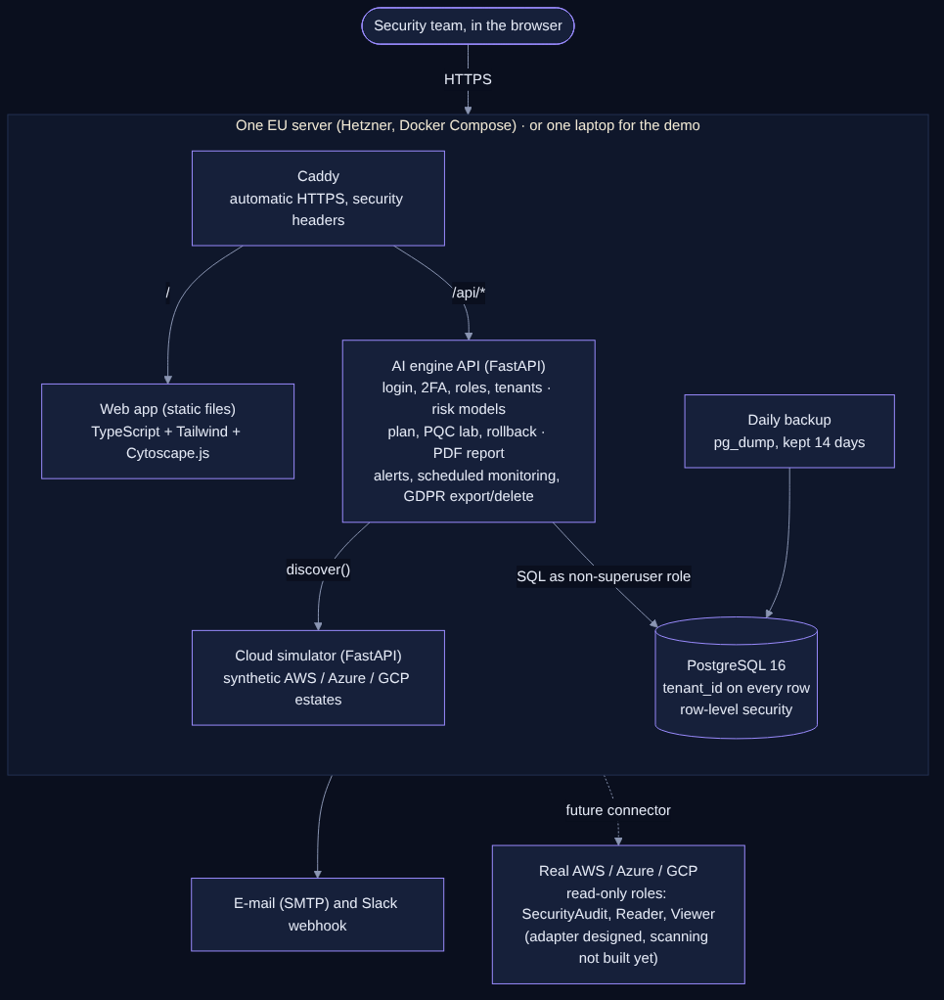

# Architecture



## Components

| Component | Technology | Role |
|---|---|---|
| Web app | TypeScript (compiled to ES modules, no framework), Tailwind CSS, Cytoscape.js, hand-built SVG charts | All pages; talks only to `/api` |
| Caddy | Caddy 2 | HTTPS with automatic Let's Encrypt certificates, security headers, serves the web app, proxies `/api/*` |
| AI engine API | Python 3.12, FastAPI | Accounts, sessions, 2FA, roles, tenants, discovery runs, risk models, plan, PQC lab, report, alerts, monitoring, GDPR |
| Cloud simulator | Python, FastAPI | `GET /estate?profile&seed&n&drift` returns a synthetic multi-cloud estate; `drift` adds new services over time so monitoring has something to find |
| Database | PostgreSQL 16 (server) or SQLite (laptop) | All data, with `tenant_id` on every tenant row |
| Backup | `pg_dump` loop | Daily compressed dump, 14 days kept |

On the laptop, the engine also serves the web app and runs the simulator in-process, so one process and one SQLite file
are enough. The code path is the same.

## Request flow

1. The browser loads the static app from Caddy (or the engine on the laptop).
2. Every API call sends the session cookie (HttpOnly, SameSite=Strict) and the header `X-QM-Request: 1` (CSRF guard).
3. The engine resolves the session → user → tenant and role, checks the permission, then opens a database transaction
   that sets `app.tenant_id`. PostgreSQL policies only return rows of that tenant.
4. Heavy objects (trained models, graph layout) are loaded once per tenant and cached in memory.

## Discovery and AI pipeline

```
connector.discover()  →  assets + dependencies stored (algorithm_discovered / algorithm_current)
                      →  dependency graph (NetworkX): dependants, PageRank, betweenness, inherited exposure
                      →  rule score  Risk = 100 × (0.25 C + 0.20 S + 0.15 R + 0.15 E + 0.15 D + 0.10 B)
                      →  5 models trained on analyst labels (70/30 split + 5-fold CV):
                         rule-based · Random Forest · MLP · MLP + graph features (in use) · SIGN graph neural network
                      →  per-asset explanation (reasons, formula contributions, occlusion attributions)
                      →  plan: priority = 0.40 rule + 0.35 AI + 15 × dependency impact + 0.10 × (100 − effort)
                         waves: ranks 1–20, 21–60, rest
```

A migration changes `algorithm_current` only; risk is recomputed for the asset and everything that depends on it,
without retraining. Every change is a row in `migrations` (with the previous algorithm) and in `audit_log`.

## Data model (main tables)

`tenants`, `users` (role, scrypt hash, encrypted TOTP secret), `sessions` (SHA-256 of the token), `tenant_settings`,
`cloud_connections`, `discovery_runs`, `assets`, `dependencies`, `model_runs` (trained bundle), `migrations`,
`alerts`, `notification_outbox`, `audit_log`.

## Multi-tenancy

- Application level: every query filters on `tenant_id`.
- Database level (PostgreSQL): `ENABLE` + `FORCE ROW LEVEL SECURITY` with a policy
  `tenant_id = current_setting('app.tenant_id')` on every tenant table. The app connects as a non-superuser role
  (`DATABASE_URL`); the superuser URL (`DATABASE_ADMIN_URL`) is used only at start-up to create the schema, the role and
  the policies. Login looks up users through one `SECURITY DEFINER` function.
- Tests read across tenants directly in SQL and confirm nothing leaks.

## Cloud connectors

`CloudConnector` has two methods: `test()` and `discover(run_index)`. `SimulatorConnector` works (in-process or over
HTTP). `AwsConnector`, `AzureConnector` and `GcpConnector` document the read-only API calls they will use, and the
connection page shows the access to grant:

| Cloud | Access | Reads |
|---|---|---|
| AWS | IAM role with `SecurityAudit` + `AWSCertificateManagerReadOnly`, external ID | KMS keys, ACM certificates, ELB/CloudFront TLS policies, RDS/S3 encryption settings |
| Azure | Service principal with `Reader` + `Key Vault Reader` | Key Vault key and certificate metadata, App Gateway / Front Door TLS, Storage / SQL encryption |
| GCP | Service account with `roles/viewer` + `roles/cloudkms.viewer` | Cloud KMS keys, Certificate Manager, load-balancer SSL policies, Cloud SQL / GCS encryption |

None of these roles can read secrets, private keys or customer data.

## Scaling notes

One engine worker is used because login rate limits and the model cache live in memory (sessions are in the database). For more users: move rate
limits to PostgreSQL or Redis, then run several workers. Training takes about 10–40 s per tenant per discovery.
